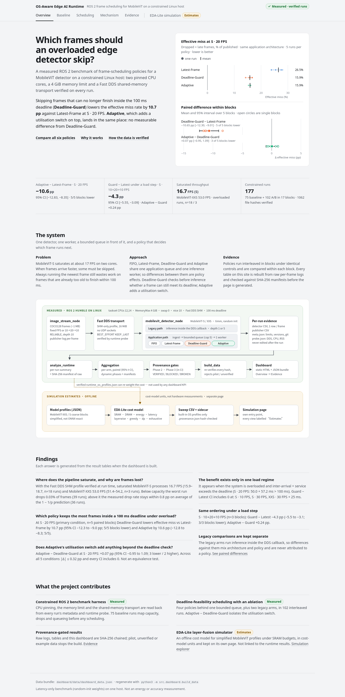
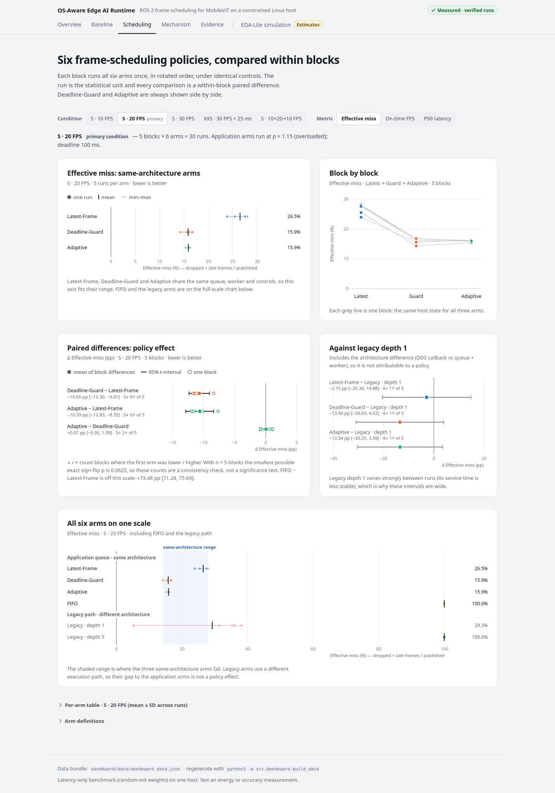
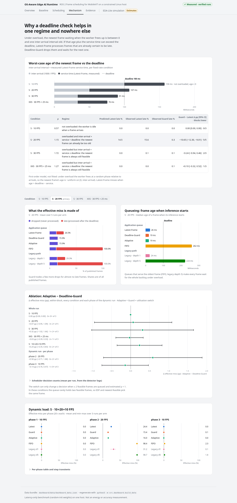
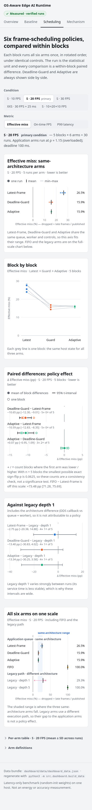
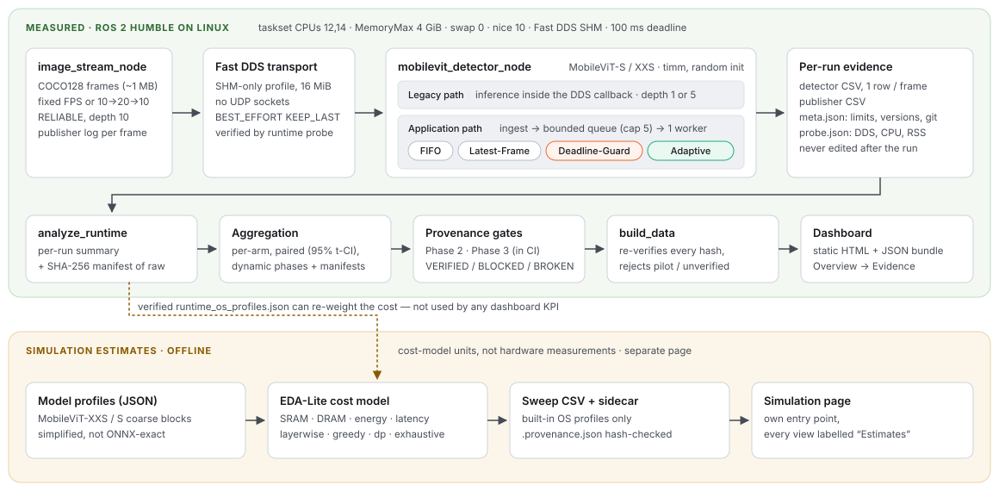

# OS-Aware Edge AI Runtime

**OS-Aware Edge AI Runtime** is a measured study of **frame scheduling for a MobileViT detector in ROS 2** on a resource-constrained Linux host, plus an offline **EDA-inspired layer-fusion simulator**. Every runtime number is traced by SHA-256 from raw per-frame logs to the dashboard, and simulation estimates are kept visibly separate from measurements.



| | |
|---|---|
| **Question** | When a ROS 2 vision node is overloaded, which frame-scheduling policy keeps the most frames inside a 100 ms end-to-end deadline, and why? |
| **System** | ROS 2 Humble · Fast DDS shared memory (verified at run time) · MobileViT-S / XXS (timm) · 2 pinned CPU cores, 4 GiB, no swap |
| **Evidence** | 177 constrained runs: 75-run baseline + 102-run interleaved A/B benchmark (17 blocks × 6 policies), provenance gates `VERIFIED` |
| **Answer** | Dropping frames that can no longer meet their deadline cuts effective miss by **10.65 pp** vs Latest-Frame at the primary condition. Adaptive's utilisation switch adds **nothing measurable** on top. |
| **Dashboard** | Static, offline, five views + a separate simulation page: [`dashboard/`](dashboard/) · `bash scripts/serve_dashboard.sh` |

中文摘要：本專案在受限的 Linux 主機（2 個 CPU 核心、4 GiB、Fast DDS SHM）上，以 ROS 2 量測 MobileViT 偵測節點的排程策略。177 個受控 run（75 baseline + 102 交錯 A/B）顯示：真正有效的是「丟棄必定超時的 frame」（Deadline-Guard）；Adaptive 的利用率切換沒有觀察到額外貢獻。EDA-Lite 為離線模擬，數值為成本模型估計，與實測結果分開呈現。

## Key findings

All values are within-block paired differences (mean, 95 % Student-t interval, blocks lower / total) from `results/csv/ros2_phase3_formal_paired.csv`, as shown in the dashboard.

1. **Capacity is set by service time, not transport.** Saturated, MobileViT-S processes **16.7 FPS** and MobileViT-XXS **53.0 FPS** (processed FPS of overloaded runs). Below capacity no run loses more than 0.03 % of frames; above it, drops follow `1 − 1/ρ` within 0.76 pp on average.
2. **Deadline feasibility dropping is the effective mechanism.** At MobileViT-S 20 FPS (pre-registered primary condition, n = 5 blocks), **Deadline-Guard − Latest-Frame = −10.65 pp** effective miss, 95 % CI [−12.30, −9.01], lower in 5/5 blocks; late frames fall from 15.6 % to 0.3 % of processed frames at the cost of +2.7 pp drops.
3. **Adaptive adds no measurable benefit over Deadline-Guard.** **Adaptive − Deadline-Guard = +0.07 pp**, 95 % CI [−0.95, 1.09] (3 lower / 2 higher); across all five conditions |Δ| ≤ 0.32 pp and every interval includes 0. In this load range the utilisation switch never changes the decisive choice. (No difference ≠ equivalence; no equivalence test was run.)
4. **The benefit exists in one regime only.** It appears when the detector is overloaded *and* inter-arrival + service time exceeds the deadline (S 20 FPS: 50 + 57 ms > 100 ms). At S 30 FPS, XXS 30 FPS + 25 ms and S 10 FPS the intervals include 0, as the frame-age bound predicts.
5. **Same ordering under a load step.** S 10 → 20 → 10 FPS (n = 3): Guard − Latest **−4.32 pp** [−5.55, −3.09], 3/3 blocks; Adaptive − Guard +0.24 pp.

Comparisons with the legacy path (inference inside the DDS callback) also contain an architecture difference and are reported separately, never as a policy effect.

## Dashboard

A static site in [`dashboard/`](dashboard/): plain HTML/CSS/JS, inline SVG charts, no CDN or framework, works offline and from `file://`.

| View | What it answers |
|---|---|
| **Overview** | Research questions, headline result with its interval, system architecture |
| **Baseline** | Throughput saturation, drop model `1 − 1/ρ`, queue depth vs latency, injected delay (Phase 2) |
| **Scheduling** | Six policies per condition: per-run dots, block-by-block slopes, paired differences with 95 % CI; legacy comparisons in their own panel |
| **Mechanism** | Frame-age bound vs deadline, drop/late decomposition, queueing age, Adaptive − Guard ablation, dynamic load |
| **Evidence** | Hash-chain checks, run inventory, controlled variables from every `meta.json`, method, limitations, excluded data, sources with SHA-256 |
| **EDA-Lite simulation** (separate page) | Layer-fusion estimates by SRAM budget, scheduler and OS profile, labelled *Estimates* throughout |

Filters (condition, metric, model) are kept in the URL, e.g. `index.html#scheduling?c=s20&m=on_time_fps`. Desktop and phone layouts, light and dark themes, hover / keyboard tooltips, and a table behind every chart.

| Scheduling | Mechanism | Phone |
|---|---|---|
|  |  |  |

**Open it on the server (VS Code Remote SSH):**

```bash
bash scripts/serve_dashboard.sh          # checks the data, then serves 127.0.0.1:8765 (next free port if taken)
```

VS Code forwards the port automatically (Ports panel → open in browser). The server binds to `127.0.0.1` only; nothing is exposed on the network. Without VS Code: `ssh -L 8765:127.0.0.1:8765 <server>`. Or open `dashboard/index.html` directly.

**Data pipeline.** `python3 -m src.dashboard.build_data` reads only the Phase 2 baseline and Phase 3 formal tables (plus built-in-profile simulation estimates for the separate page), re-verifies every SHA-256 manifest down to the raw runs, and writes `dashboard/data/dashboard_data.{json,js}` and a manifest. All KPIs and finding sentences are computed there; the front end only formats them. It refuses to write anything if an input is missing (exit 1 `BLOCKED`), a hash or invariant fails, or pilot / legacy-unverified / example data appears (exit 2 `BROKEN`). `--check` exits 3 `STALE` if the committed bundle differs from a fresh build.

## Architecture



- **Publisher** `image_stream_node`: COCO128 frames (~1 MB) at a fixed rate or a step schedule (`fps_schedule="10@20,20@20,10@20"`), one log row per published frame.
- **Transport**: Fast DDS SHM-only profile (16 MiB segment). A runtime probe proves per run that no UDP socket was opened and the segment size matches; otherwise the run fails.
- **Detector** `mobilevit_detector_node`, two execution paths:
  - *legacy*: inference inside the DDS callback; KEEP_LAST depth is the only queue;
  - *application*: ingestion callback → bounded queue (capacity 5) → one inference worker, with policy `fifo`, `latest_frame`, `deadline_guard` or `adaptive` (`src/ros2_uav_pipeline/mobilevit_uav_pipeline/scheduling.py`, unit-tested without ROS).
- **Per-run evidence**: detector CSV, publisher CSV, `meta.json` (limits read back, versions, git commit/dirty), `probe.json`.
- **Analysis** (`src/ros2_runtime/`, stdlib): per-run summary → per-condition / per-arm / paired / dynamic-phase tables, each with a SHA-256 manifest.
- **Gates**: `scripts/check_runtime_provenance.py` (Phase 2) and `scripts/check_phase3_provenance.py` (Phase 3).
- **EDA-Lite** (`src/eda_lite/`): simplified MobileViT block profiles → SRAM-constrained fusion (`layerwise`, `greedy`, exact `dp`, `exhaustive` oracle) → DRAM traffic, energy and latency *estimates*. Offline; not linked to the runtime KPIs.

### Deadline-Guard vs Adaptive in one paragraph

Both share the queue, a P90 service-time estimator over the last 32 frames and a feasibility check: a frame is dropped (`deadline_infeasible`) if `age + estimated service > deadline`. Deadline-Guard always serves the newest feasible frame. Adaptive additionally switches to EDF (oldest feasible) when estimated utilisation ρ̂ < 1. That switch can only matter when ≥ 2 feasible frames are queued while ρ̂ < 1, which did not happen often enough in these conditions to be measurable.

## Quickstart

Python 3.10–3.13, standard library only (nothing to install) for the simulator, analysis, dashboard and tests:

```bash
python3 -m unittest discover -s tests                 # 266 tests (ROS 2 parts are mocked)
bash scripts/ci_checks.sh all                         # exactly what GitHub Actions runs
python3 scripts/check_runtime_provenance.py           # Phase 2 gate -> VERIFIED
python3 scripts/check_phase3_provenance.py --expect-runs 102   # Phase 3 gate -> VERIFIED
python3 -m src.dashboard.build_data --check           # dashboard bundle current
bash scripts/serve_dashboard.sh                       # preview on 127.0.0.1:8765
```

Run the simulator:

```bash
python3 -m src.eda_lite.run_profile_sweep \
  --config experiments/eda_lite/mobilevit_profile_sweep.json \
  --output /tmp/eda_lite_mobilevit_profile_sweep.csv   # + .provenance.json sidecar
```

The ROS 2 benchmark itself needs Linux + ROS 2 Humble (`conda env create -f environment.yml`); see [`experiments/ros2/README.md`](experiments/ros2/README.md) and [`docs/REFERENCE.md`](docs/REFERENCE.md).

## Benchmark methodology

| Item | Setting |
|---|---|
| Host | Intel i7-13700, Ubuntu 22.04, kernel 6.8; CPUs 12 and 14 via `taskset`; `systemd-run --scope` MemoryMax 4 GiB, swap 0; `nice 10`; no sudo, no sysctl changes |
| Middleware | ROS 2 Humble, `rmw_fastrtps_cpp`, SHM-only XML (hash recorded, applied state probed per run), `ROS_DOMAIN_ID=87` |
| Workload | COCO128 images; publisher RELIABLE depth 10 → detector BEST_EFFORT KEEP_LAST; timm MobileViT with random weights (latency only) |
| Metrics | Effective miss = (late + dropped) / published; on-time FPS; P50/P95/P99 end-to-end latency; drop and late shares; frame age at inference start; CPU / RSS / cgroup peak |
| Phase 2 baseline | 2 models × input rate / queue depth / injected delay, 3 runs each, 60 s (75 runs) |
| Phase 3 formal A/B | 5 conditions × 6 arms in interleaved blocks with rotated arm order (S 20 FPS: 5 blocks; others: 3), 65 s runs, load gate before every block, measured from a clean detached worktree (102 runs) |
| Statistics | Run = unit. Within-block paired differences, 95 % Student-t interval, block sign counts, exact sign-flip p (floor 0.0625 at n = 5, so reported as consistency, not significance). Analysis plan and Adaptive parameters fixed before the formal data |
| Controls | 25 settings read from every Phase 3 `meta.json` and required identical (Evidence view) |

## Reproducibility

```text
results/raw/{ros2,ros2_phase3_formal}/<run_id>.{csv,publisher.csv,meta.json,probe.json}   (never edited)
  → results/csv/*_summary.csv + .manifest.json             analyze_runtime
  → results/csv/ros2_baseline_*.csv, ros2_phase3_formal_*.csv + manifests
  → scripts/check_runtime_provenance.py / check_phase3_provenance.py   VERIFIED
  → dashboard/data/dashboard_data.{json,js} + .manifest.json   src.dashboard.build_data
```

- `python3 scripts/check_table_regeneration.py` rebuilds every Phase 2 / Phase 3 table from the raw runs into a temporary directory and compares: the 7 Phase 3 tables and the baseline condition table are byte-identical; the two Phase 2 per-run tables match on every committed column (the current analyzer appends 20 Phase 3 columns). The exact commands are in that script and in [`docs/REFERENCE.md`](docs/REFERENCE.md).
- `python3 -m src.dashboard.build_data` then regenerates the dashboard bundle; output is deterministic (no timestamps), so `--check` can compare bytes.
- CI (`.github/workflows/ci.yml`, locally `bash scripts/ci_checks.sh all`): tests on Python 3.10–3.13, `bash -n`, audit regressions, both provenance gates, table regeneration, dashboard bundle check.
- The Phase 3 gate checks that the measurement commit `7f0f160` is an ancestor of `HEAD` with runtime code unchanged since. Use a full clone (not `--depth 1`), and merge this history without squashing or rebasing, or the gate reports `BROKEN`.
- `results/README.md` lists every result file with its provenance status. Pilot data (`results/raw/ros2_phase3_pilot/`) is kept for the record; its gate reports `BROKEN` by design (dirty tree) and it is never used.

## Repository layout

```text
src/ros2_uav_pipeline/   ROS 2 package: publisher, detector, scheduling policies, launch file
src/ros2_runtime/        analysis: analyze_runtime, aggregate_{baseline,scheduling}, analyze_dynamic_phases,
                         run_metadata, runtime_probe, host_load_gate, build_os_profiles, plot_scheduling
src/eda_lite/            simulator: model_loader, cost_model, schedulers, run_simulation, run_profile_sweep, ...
src/dashboard/           build_data.py: verified tables -> dashboard bundle
src/provenance.py        SHA-256 records, manifests, provenance status
dashboard/               index.html, simulation.html, assets/ (style, charts, app, architecture.svg), data/
experiments/ros2/        sweep / formal-A/B drivers, Fast DDS SHM profile
experiments/eda_lite/    simulation configs, OS profiles (verified / example / legacy-unverified)
results/                 raw/ (runs), csv/ (tables + manifests), figures/ (script-generated SVG)
scripts/                 CI steps, provenance gates, table regeneration check, dashboard server
tests/                   unittest, stdlib only
report/                  per-phase result reports, final report draft, AI interaction log
docs/                    REFERENCE.md (detailed manual), images/ (dashboard screenshots)
```

## Limitations

- **One host, one session per phase.** Results describe this i7-13700 with two P-cores, the `powersave` governor and a shared machine (load gate + nice). They do not establish behaviour on other hardware.
- **Small samples.** 5 blocks for the primary condition, 3 for the others. Effect sizes and intervals are reported; no claim of statistical significance is made.
- **One parameter set.** 100 ms deadline, queue capacity 5, one Adaptive configuration, one step pattern. The utilisation switch might matter with ρ ≈ 1 and longer queues, deadlines far above service time, or high service-time variance; untested.
- **Architecture effects.** Legacy vs application differs by more than the policy (XXS application arms are ~1.2 ms/frame slower; legacy service time varies more between runs, cause not measured).
- **Latency only.** Random-initialised weights, no accuracy. **No energy was measured**; EDA-Lite energy is a cost-model estimate.
- **EDA-Lite is a simplified simulator.** Coarse block profiles (not ONNX-exact), lightweight cost model; it is inspired by, and does not reproduce, the EDA compiler paper. OS profiles re-weight the cost but do not change the chosen partition on these profiles.

## Future work

- Probe the regimes where Adaptive could differ: ρ ≈ 1 with longer queues, larger deadline / service ratios, bursty or high-variance service times.
- Repeat on other hardware and across days; add a CPU governor / isolation sweep.
- Pretrained weights to report accuracy alongside latency.
- Re-run the EDA-Lite runtime-aware sweep with the verified `runtime_os_profiles.json` (currently only example / legacy profiles were used there).
- Formal equivalence testing (TOST) with a pre-declared margin for Adaptive vs Guard.

## Data and third-party notices

- **Images are not redistributed.** The benchmark streams the COCO128 subset of COCO 2017 (Ultralytics release), downloaded by `experiments/ros2/prepare_coco128.sh` into the git-ignored `data/raw/images/`. COCO annotations are CC BY 4.0; the images remain under their original Flickr licenses ([COCO terms of use](https://cocodataset.org/#termsofuse)). The raw run logs in `results/raw/` record frame ids and timings only, no image content.
- **Model.** MobileViT (Mehta & Rastegari, ICLR 2022) via `timm` (Apache-2.0) with random-initialised weights; no pretrained weights are included or downloaded. `data/model_profiles/*` are simplified block summaries derived from the published architecture.
- **Runtime.** ROS 2 Humble and eProsima Fast DDS (Apache-2.0), PyTorch (BSD-3-Clause) — installed separately, not vendored.
- **Run metadata.** `results/raw/**/*.meta.json` and `*.probe.json` record the measurement host's kernel, CPU model, cgroup scope and the local install paths of the Python / Fast DDS profile. They are part of the SHA-256 provenance chain and are kept unedited.

## Project history

| Phase | Result | Report |
|---|---|---|
| 1 | EDA-Lite simulator, audit fixes, CI, provenance tooling | `report/PHASE1_*` |
| 2 | Linux + ROS 2 environment; 75-run constrained baseline, provenance VERIFIED | `report/PHASE2_BATCH{1,2}_RESULT.md` |
| 3 | Scheduling policies + pilot; 102-run formal A/B with Deadline-Guard ablation | `report/PHASE3_BATCH{1,2}_RESULT.md` |
| 4 | Dashboard, data pipeline, documentation | `report/PHASE4_RESULT.md` |

Detailed command reference, CSV contracts, config formats and cost-model notes: [`docs/REFERENCE.md`](docs/REFERENCE.md). Contributor / agent rules: [`AGENTS.md`](AGENTS.md).
