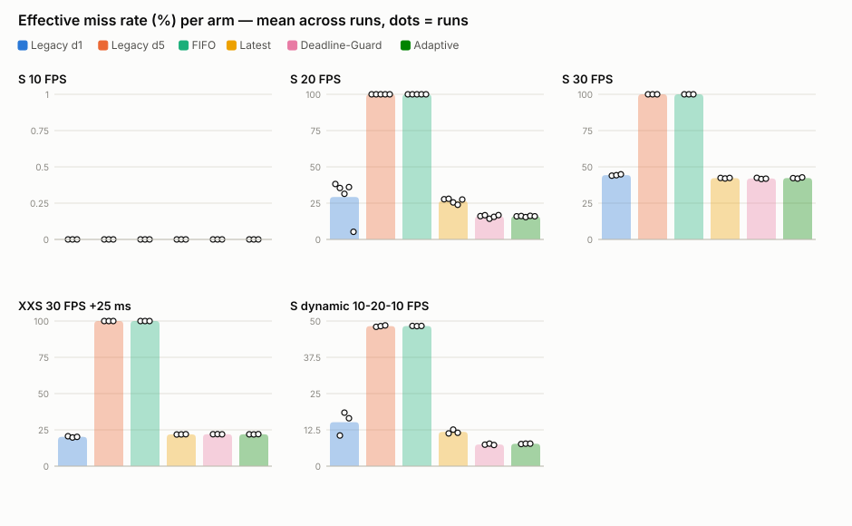
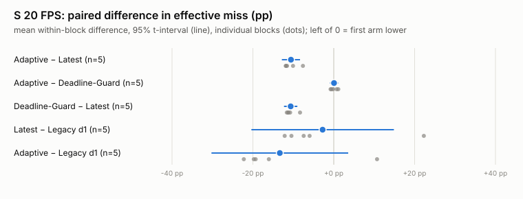
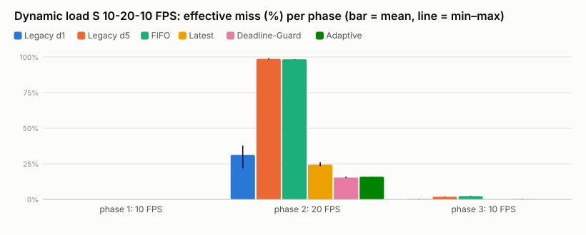

# Phase 3 / Batch 2：Formal A/B Benchmark & Adaptive Validation

- 日期：2026-11-11（正式量測 11:44–13:37 +08:00，單一連續 session）
- 分支：`phase3/batch2-formal-ab`，從 Phase 3 / Batch 1 最新 commit `a4f1f01` 建立（建立前 working tree clean）。**未 push、未 merge、未修改 `main`**。
- Commits：
  - `7f0f160`：量測所用的程式碼（`deadline_guard`、動態 publisher、formal driver、load gate）。
  - `b9b242c`：分析工具、Phase 3 provenance gate、測試。
  - 本批次的 data + docs + report commit。

## 一句話結論

**Deadline-aware 策略在特定過載區間有可重現的優勢，但優勢完全來自「deadline 可行性檢查（丟棄必定超時的 frame 並等待新 frame）」，不是 Adaptive 的利用率切換。**

- **主要條件 S 20 FPS（5 個 paired blocks）**：Adaptive 的 effective miss 比 Latest-Frame 低 **10.6 pp**（95% CI [−12.8, −8.4]，5/5 blocks），on-time FPS +2.1。更簡單的 **Deadline-Guard 與 Adaptive 無法區分**（Δ +0.07 pp，CI [−1.0, +1.1]，blocks 3 負 / 2 正）。
- **動態負載 S 10→20→10 FPS（3 個 paired blocks）**：整體結果相同，Adaptive − Latest 為 −4.1 pp（3/3 blocks），Adaptive ≈ Guard。
- **S 30 FPS、XXS 30 FPS +25 ms（受控過載）與 S 10 FPS**：三種 deadline / latest 策略之間**沒有差異**。
- **判定**：Adaptive 本身**沒有**超出 Deadline-Guard 的可重現優勢。「deadline-aware 優於 Latest-Frame」則在 inter-arrival + service > deadline 的條件下可重現。量測與 provenance 已具備進入最終 Dashboard 階段的條件（見 §10）。

## 1. 前置確認與預先固定的分析計畫

| 項目 | 狀態 |
|---|---|
| 必讀文件 | `AGENTS.md`、`report/PHASE3_BATCH1_RESULT.md`、`scheduling.py`、detector / publisher / launch、`analyze_runtime.py`、`aggregate_scheduling.py`、`run_sched_{pilot,sweep}.sh`、`run_baseline_experiments.sh`、pilot raw / meta / probe |
| Batch 1 是否已 commit | 是。`phase3/scheduling-policies` @ `a4f1f01`，tree clean；本分支從該處建立 |
| 控制變數（與 Batch 1/2 相同，逐 run 驗證，§6） | 主機 i7-13700；`taskset -c 12,14` + `systemd-run --user --scope -p MemoryMax=4G -p MemorySwapMax=0`；`nice 10`；`ROS_DOMAIN_ID=87`；`rmw_fastrtps_cpp` + `fastdds_shm_large.xml`（SHA-256 `b2a1505f…`，probe 執行期驗證 SHM-only）；COCO128；timm random-init；warm-up 10；deadline 100 ms；`intra_op_threads=1`（所有 arm）；application arms 的 DDS depth 10、queue capacity 5 |
| Adaptive 參數 | 與 Batch 1 相同（quantile 0.9、window 32、margin 0、threshold 1.0），**未根據 pilot 調整**。`params_text` 與 pilot 逐字相同（有測試）|

**預先固定的分析計畫（在看到正式資料前寫入程式與測試）：**

- 主要指標：effective miss rate、on-time FPS。
- 次要指標：P50 / P95 / P99 latency、drop rate、frame freshness（P50 frame age at start）、service time、CPU / RSS。
- 統計單位是 run。比較以同一 block 內的成對差異為準，報告平均、SD、95% Student-t 區間、正負 block 數，以及 exact sign-flip p。
  - n = 5 時，sign-flip p 最小只能到 0.0625，所以它只作為一致性指標，不作為顯著性門檻。
- 主要因果比較只在相同 application 架構內進行：Adaptive − Latest、Adaptive − Deadline-Guard、Deadline-Guard − Latest。
- 與 legacy 的比較另外列出，並標示其中可能包含架構差異（§7）。

## 2. 實作（最小修改）

| 修改 | 內容 |
|---|---|
| `deadline_guard` 策略（`scheduling.py`，+23 行） | 與 Adaptive 共用同一個 queue（capacity 5，滿了丟最舊）、同一個 service-time estimator（最近 32 個非 warm-up 的 P90），以及同一套 feasibility check 和 `no_estimate` / `wait` / `best_effort` 分支。**唯一差異**：在 `_select_adaptive` 中設定 `overloaded = True`，也就是不管 ρ̂ 多少，都取最新的可行 frame。等同於「Latest-Frame + deadline guard」。|
| 動態 publisher（`image_stream_node.py`、`run_log.py`、launch） | 新參數 `fps_schedule="10@20,20@20,10@20"`（FPS@秒，從 frame 0 起算）。以 `Timer.timer_period_ns` 原地改變週期，不在 callback 中銷毀 timer。<br>預設為空字串：固定 FPS 模式與 publisher log 格式都不變，launch 只在有設定時才轉送這個參數。<br>使用 `@` 而不是 `:`，因為 ROS 2 參數會經過 YAML 解析，`10:20` 會被讀成六十進位的 620。|
| `run_sched_sweep.sh` | 新增 `deadline_guard` arm（label `guard_c5_q10`）。`FPS_SCHEDULE` 會設定 `scenario=sched_dynamic`，並把 `fps_schedule` 寫入 meta.json。|
| `run_sched_formal.sh` | 正式 driver。<br>block 排程：每個條件的 block 平均分散在 5 個 round 中；同一 round 內條件順序輪轉；每個 block 的 arm 順序輪轉，同一條件中每個 block 的第一個 arm 都不同。<br>每個 block 前檢查 git clean（否則 exit 3），並通過 `host_load_gate`（否則 exit 4）。|
| `host_load_gate.py` | 檢查 CPU 12、14 以及其 SMT siblings 13、15 在 3 s 內的 busy < 15%，且 loadavg < 6。不通過時每 30 s 重試，決策寫入 `load_gate.jsonl`。|

**量測環境的隔離**：正式量測在 commit `7f0f160` 的 detached git worktree（repo 外）中執行，所以在主目錄開發分析程式時，不可能讓 run 變成 dirty。這是 Batch 1 §10.1 問題的根本解法。量測結束後把資料複製進 repo，並以 SHA-256 逐檔比對：相同。

## 3. 實驗矩陣

| 條件 | Model | 輸入 | Delay | ρ（app arms） | 類型 | Blocks | Runs |
|---|---|---|---|---|---|---|---|
| **S20（主要）** | MobileViT-S | 20 FPS | 0 | 1.15 | 過載 | **5** | 30 |
| S10 | MobileViT-S | 10 FPS | 0 | 0.58 | 未過載 | 3 | 18 |
| S30 | MobileViT-S | 30 FPS | 0 | 1.72 | 高負載 | 3 | 18 |
| XXS30d25 | MobileViT-XXS | 30 FPS | 25 ms（artificial） | 1.27 | 受控過載 | 3 | 18 |
| Sdyn | MobileViT-S | 10 → 20 → 10 FPS（各 20 s） | 0 | 0.58 → 1.15 → 0.58 | 動態負載 | 3 | 18 |
| **合計** | | | | | | **17** | **102** |

- 6 個 arm：`legacy_q1`、`legacy_q5`、`fifo_c5_q10`、`latest_q10`、`guard_c5_q10`、`adaptive_c5_q10`。每個 block 中每個 arm 恰好一次。
- 每個 run 是 65 s timeout。扣掉啟動時間後，實際發布 frame 的時間為 62.4–63.3 s，所以每個 run ≥ 60 s。
- 執行順序見 `DRY_RUN=1 bash experiments/ros2/run_sched_formal.sh`：
  - S20 在 round 1–5 各跑一次；其他條件在 round 1、3、5。
  - S20 中 Adaptive 在 5 個 block 的位置分別是 6、5、4、3、2。

**完成度**：

- 102/102 runs 到時正常結束，0 個 `*.failed`，102/102 `constrained`，102/102 `dds.verified`。
- 17/17 個 block 的 load gate 一次就通過（watched CPU busy ≤ 8.6%，loadavg 1.8–2.8）。
- 量測期間（probe）：loadavg 最高 3.9，SMT sibling busy 最高 13%。

## 4. 主要結果





### 4.1 表 A：各條件 × arm（mean ± SD across runs；run 是統計單位）

定義：

- ρ = offered × service / 1000。
- On-time FPS = offered × (1 − effective miss)。
- Effective miss = (deadline miss + drops) / total frames。
- Excl-tail = 從分子與分母同時移除 run 結束時才遺失的 frame（`shutdown_*` + tail）。
- P50 age = 從 publish 到開始處理的時間。

| Condition | Arm | n | ρ | Proc FPS | On-time FPS | Drop % | Deadline miss % | Eff miss % (min–max) | Excl-tail eff % | P50 | P95 | P99 (ms) | P50 age | Service ms |
|---|---|---|---|---|---|---|---|---|---|---|---|---|---|---|
| S 10 FPS | Legacy d1 | 3 | 0.60 | 10.0 | 10.0 ± 0.0 | 0.0 | 0.0 | 0.0 ± 0.0 (0.0–0.0) | 0.0 | 60.4 | 63.3 | 64.6 | 0.6 | 59.53 |
| S 10 FPS | Legacy d5 | 3 | 0.60 | 10.0 | 10.0 ± 0.0 | 0.0 | 0.0 | 0.0 ± 0.0 (0.0–0.0) | 0.0 | 60.6 | 63.7 | 64.6 | 0.6 | 59.97 |
| S 10 FPS | FIFO | 3 | 0.58 | 10.0 | 10.0 ± 0.0 | 0.0 | 0.0 | 0.0 ± 0.0 (0.0–0.0) | 0.0 | 59.1 | 61.0 | 62.2 | 0.8 | 57.54 |
| S 10 FPS | Latest | 3 | 0.58 | 10.0 | 10.0 ± 0.0 | 0.0 | 0.0 | 0.0 ± 0.0 (0.0–0.0) | 0.0 | 59.2 | 60.8 | 61.8 | 0.8 | 57.51 |
| S 10 FPS | Deadline-Guard | 3 | 0.58 | 10.0 | 10.0 ± 0.0 | 0.0 | 0.0 | 0.0 ± 0.0 (0.0–0.0) | 0.0 | 58.9 | 61.0 | 62.1 | 0.8 | 57.58 |
| S 10 FPS | Adaptive | 3 | 0.57 | 10.0 | 10.0 ± 0.0 | 0.0 | 0.0 | 0.0 ± 0.0 (0.0–0.0) | 0.0 | 58.0 | 60.9 | 62.2 | 0.8 | 57.40 |
| S 20 FPS | Legacy d1 | 5 | 1.17 | 17.1 | 14.2 ± 2.7 | 14.6 | 17.8 | 29.3 ± 13.7 (5.2–38.2) | 29.2 | 81.8 | 105.0 | 110.7 | 23.5 | 58.23 |
| S 20 FPS | Legacy d5 | 5 | 1.17 | 17.0 | 0.0 ± 0.0 | 15.0 | 100.0 | 100.0 ± 0.0 (100.0–100.0) | 100.0 | 282.0 | 307.2 | 311.7 | 223.7 | 58.36 |
| S 20 FPS | FIFO | 5 | 1.14 | 17.5 | 0.0 ± 0.0 | 12.7 | 100.0 | 100.0 ± 0.0 (100.0–100.0) | 100.0 | 318.4 | 343.4 | 350.4 | 261.7 | 57.05 |
| S 20 FPS | Latest | 5 | 1.15 | 17.4 | 14.7 ± 0.4 | 12.9 | 15.6 | 26.5 ± 1.8 (23.9–28.0) | 26.5 | 83.0 | 105.4 | 109.3 | 25.5 | 57.23 |
| S 20 FPS | Deadline-Guard | 5 | 1.16 | 16.9 | 16.8 ± 0.2 | 15.6 | 0.3 | 15.9 ± 1.0 (14.3–16.7) | 15.8 | 76.3 | 95.7 | 98.6 | 18.9 | 57.79 |
| S 20 FPS | Adaptive | 5 | 1.16 | 16.9 | 16.8 ± 0.1 | 15.7 | 0.2 | 15.9 ± 0.3 (15.4–16.3) | 15.9 | 76.2 | 95.5 | 98.7 | 18.9 | 57.83 |
| S 30 FPS | Legacy d1 | 3 | 1.78 | 16.7 | 16.7 ± 0.1 | 44.3 | 0.0 | 44.3 ± 0.5 (43.9–44.8) | 44.3 | 76.7 | 92.2 | 94.8 | 17.2 | 59.35 |
| S 30 FPS | Legacy d5 | 3 | 1.81 | 16.4 | 0.0 ± 0.0 | 45.3 | 100.0 | 100.0 ± 0.0 (100.0–100.0) | 100.0 | 211.3 | 226.5 | 229.2 | 150.9 | 60.33 |
| S 30 FPS | FIFO | 3 | 1.72 | 17.4 | 0.0 ± 0.0 | 42.2 | 100.0 | 100.0 ± 0.0 (100.0–100.0) | 100.0 | 328.2 | 347.2 | 352.0 | 271.3 | 57.26 |
| S 30 FPS | Latest | 3 | 1.72 | 17.3 | 17.3 ± 0.1 | 42.2 | 0.1 | 42.2 ± 0.2 (42.0–42.4) | 42.2 | 74.6 | 89.8 | 92.5 | 17.2 | 57.48 |
| S 30 FPS | Deadline-Guard | 3 | 1.71 | 17.5 | 17.4 ± 0.1 | 42.0 | 0.1 | 42.0 ± 0.4 (41.6–42.5) | 42.0 | 74.4 | 89.5 | 92.4 | 17.3 | 57.07 |
| S 30 FPS | Adaptive | 3 | 1.72 | 17.4 | 17.3 ± 0.1 | 42.3 | 0.1 | 42.3 ± 0.4 (41.9–42.8) | 42.3 | 74.6 | 89.9 | 92.6 | 17.3 | 57.37 |
| XXS 30 FPS +25 ms | Legacy d1 | 3 | 1.24 | 23.9 | 23.9 ± 0.1 | 20.2 | 0.0 | 20.2 ± 0.4 (19.8–20.6) | 20.2 | 58.5 | 73.6 | 75.5 | 17.2 | 41.26 |
| XXS 30 FPS +25 ms | Legacy d5 | 3 | 1.23 | 24.1 | 0.0 ± 0.0 | 19.9 | 100.0 | 100.0 ± 0.0 (100.0–100.0) | 100.0 | 191.7 | 206.7 | 208.5 | 150.7 | 41.06 |
| XXS 30 FPS +25 ms | FIFO | 3 | 1.28 | 23.4 | 0.0 ± 0.0 | 22.0 | 100.0 | 100.0 ± 0.0 (100.0–100.0) | 100.0 | 240.3 | 255.6 | 258.6 | 197.7 | 42.54 |
| XXS 30 FPS +25 ms | Latest | 3 | 1.27 | 23.4 | 23.4 ± 0.0 | 21.9 | 0.0 | 21.9 ± 0.1 (21.8–22.0) | 21.9 | 59.7 | 75.0 | 76.8 | 17.5 | 42.47 |
| XXS 30 FPS +25 ms | Deadline-Guard | 3 | 1.27 | 23.5 | 23.4 ± 0.0 | 21.9 | 0.1 | 22.0 ± 0.1 (21.9–22.1) | 21.9 | 59.8 | 74.9 | 76.8 | 17.6 | 42.43 |
| XXS 30 FPS +25 ms | Adaptive | 3 | 1.27 | 23.5 | 23.4 ± 0.0 | 21.9 | 0.1 | 22.0 ± 0.1 (21.9–22.1) | 21.9 | 59.8 | 75.0 | 76.9 | 17.5 | 42.41 |
| S dynamic 10-20-10 FPS | Legacy d1 | 3 | 0.79 | 12.2 | 11.2 ± 0.5 | 7.5 | 8.3 | 15.2 ± 4.1 (10.6–18.4) | 15.2 | 63.1 | 103.6 | 109.4 | 0.6 | 59.56 |
| S dynamic 10-20-10 FPS | Legacy d5 | 3 | 0.74 | 12.6 | 6.8 ± 0.0 | 4.4 | 45.8 | 48.2 ± 0.2 (48.0–48.5) | 48.2 | 61.3 | 300.1 | 305.8 | 0.7 | 55.91 |
| S dynamic 10-20-10 FPS | FIFO | 3 | 0.75 | 12.5 | 6.8 ± 0.0 | 5.4 | 45.3 | 48.3 ± 0.0 (48.2–48.3) | 48.3 | 60.7 | 336.5 | 344.5 | 0.9 | 57.02 |
| S dynamic 10-20-10 FPS | Latest | 3 | 0.75 | 12.4 | 11.6 ± 0.1 | 5.8 | 6.4 | 11.8 ± 0.7 (11.3–12.6) | 11.8 | 60.3 | 101.9 | 107.3 | 0.9 | 57.01 |
| S dynamic 10-20-10 FPS | Deadline-Guard | 3 | 0.76 | 12.2 | 12.2 ± 0.0 | 7.5 | 0.0 | 7.5 ± 0.2 (7.3–7.8) | 7.5 | 60.2 | 92.9 | 97.3 | 0.8 | 57.57 |
| S dynamic 10-20-10 FPS | Adaptive | 3 | 0.76 | 12.2 | 12.2 ± 0.0 | 7.6 | 0.1 | 7.7 ± 0.1 (7.6–7.8) | 7.7 | 60.4 | 92.6 | 97.5 | 0.8 | 57.88 |

### 4.2 表 C：同一 block 內的成對差異（arm − reference）

欄位說明：mean [95% t-interval]；blocks −/+ = 差異為負 / 正的 block 數；sign-flip p 是 exact 雙尾值（n=5 最小 0.0625，n=3 最小 0.25）。

| Condition | Comparison | n | Δ eff miss pp mean [95% CI] | blocks −/+ | sign-flip p | Δ on-time FPS [95% CI] | Δ P99 ms [95% CI] | Δ drop pp | Δ deadline miss pp | Δ service ms [95% CI] |
|---|---|---|---|---|---|---|---|---|---|---|
| S 10 FPS | Adaptive − Latest | 3 | 0.00 [0.00, 0.00] | 0/0 | 1.000 | 0.00 [0.00, 0.00] | 0.4 [-0.7, 1.5] | 0.00 | 0.00 | -0.12 [-1.23, 1.00] |
| S 10 FPS | Adaptive − Deadline-Guard | 3 | 0.00 [0.00, 0.00] | 0/0 | 1.000 | 0.00 [0.00, 0.00] | 0.1 [-0.7, 0.9] | 0.00 | 0.00 | -0.18 [-1.02, 0.65] |
| S 10 FPS | Deadline-Guard − Latest | 3 | 0.00 [0.00, 0.00] | 0/0 | 1.000 | 0.00 [0.00, 0.00] | 0.3 [-1.0, 1.6] | 0.00 | 0.00 | 0.07 [-0.21, 0.34] |
| S 10 FPS | Latest − Legacy d1 | 3 | 0.00 [0.00, 0.00] | 0/0 | 1.000 | 0.00 [0.00, 0.00] | -2.8 [-9.7, 4.1] | 0.00 | 0.00 | -2.02 [-11.19, 7.14] |
| S 10 FPS | Adaptive − Legacy d1 | 3 | 0.00 [0.00, 0.00] | 0/0 | 1.000 | 0.00 [0.00, 0.00] | -2.4 [-8.4, 3.7] | 0.00 | 0.00 | -2.14 [-10.32, 6.04] |
| S 10 FPS | Deadline-Guard − Legacy d1 | 3 | 0.00 [0.00, 0.00] | 0/0 | 1.000 | 0.00 [0.00, 0.00] | -2.5 [-8.0, 3.1] | 0.00 | 0.00 | -1.95 [-10.87, 6.97] |
| S 10 FPS | FIFO − Latest | 3 | 0.00 [0.00, 0.00] | 0/0 | 1.000 | 0.00 [0.00, 0.00] | 0.5 [-0.9, 1.8] | 0.00 | 0.00 | 0.02 [-0.59, 0.64] |
| S 20 FPS | Adaptive − Latest | 5 | -10.59 [-12.83, -8.35] | 5/0 | 0.062 | 2.12 [1.67, 2.56] | -10.6 [-12.0, -9.2] | 2.77 | -15.35 | 0.60 [-0.15, 1.36] |
| S 20 FPS | Adaptive − Deadline-Guard | 5 | 0.07 [-0.95, 1.09] | 3/2 | 0.938 | -0.01 [-0.22, 0.19] | 0.0 [-0.6, 0.7] | 0.12 | -0.06 | 0.04 [-0.66, 0.73] |
| S 20 FPS | Deadline-Guard − Latest | 5 | -10.65 [-12.30, -9.01] | 5/0 | 0.062 | 2.13 [1.80, 2.46] | -10.7 [-11.5, -9.8] | 2.66 | -15.29 | 0.57 [0.01, 1.12] |
| S 20 FPS | Latest − Legacy d1 | 5 | -2.75 [-20.38, 14.88] | 4/1 | 0.688 | 0.55 [-2.97, 4.08] | -1.4 [-5.5, 2.8] | -1.60 | -2.18 | -1.00 [-6.48, 4.48] |
| S 20 FPS | Adaptive − Legacy d1 | 5 | -13.34 [-30.25, 3.58] | 4/1 | 0.125 | 2.67 [-0.71, 6.05] | -12.0 [-15.6, -8.5] | 1.18 | -17.53 | -0.40 [-5.63, 4.83] |
| S 20 FPS | Deadline-Guard − Legacy d1 | 5 | -13.40 [-30.83, 4.02] | 4/1 | 0.125 | 2.68 [-0.80, 6.17] | -12.1 [-15.9, -8.2] | 1.06 | -17.47 | -0.44 [-6.00, 5.13] |
| S 20 FPS | FIFO − Latest | 5 | 73.48 [71.28, 75.69] | 0/5 | 0.062 | -14.70 [-15.14, -14.26] | 241.1 [237.0, 245.2] | -0.23 | 84.41 | -0.18 [-0.45, 0.10] |
| S 30 FPS | Adaptive − Latest | 3 | 0.08 [-0.65, 0.80] | 2/1 | 1.000 | -0.02 [-0.24, 0.20] | 0.1 [-0.0, 0.1] | 0.06 | 0.03 | -0.11 [-0.82, 0.59] |
| S 30 FPS | Adaptive − Deadline-Guard | 3 | 0.32 [-1.02, 1.66] | 1/2 | 0.500 | -0.09 [-0.50, 0.32] | 0.2 [-1.7, 2.0] | 0.32 | 0.00 | 0.31 [-1.04, 1.66] |
| S 30 FPS | Deadline-Guard − Latest | 3 | -0.24 [-0.94, 0.46] | 2/1 | 0.500 | 0.07 [-0.15, 0.30] | -0.1 [-2.0, 1.8] | -0.26 | 0.03 | -0.42 [-1.08, 0.24] |
| S 30 FPS | Latest − Legacy d1 | 3 | -2.10 [-3.28, -0.91] | 3/0 | 0.250 | 0.63 [0.28, 0.97] | -2.2 [-3.3, -1.2] | -2.12 | 0.03 | -1.86 [-3.11, -0.62] |
| S 30 FPS | Adaptive − Legacy d1 | 3 | -2.02 [-2.76, -1.28] | 3/0 | 0.250 | 0.61 [0.38, 0.83] | -2.2 [-3.3, -1.1] | -2.06 | 0.06 | -1.98 [-2.64, -1.31] |
| S 30 FPS | Deadline-Guard − Legacy d1 | 3 | -2.34 [-4.22, -0.46] | 3/0 | 0.250 | 0.70 [0.13, 1.27] | -2.3 [-4.5, -0.2] | -2.37 | 0.06 | -2.28 [-4.18, -0.38] |
| S 30 FPS | FIFO − Latest | 3 | 57.76 [57.22, 58.30] | 0/3 | 0.250 | -17.33 [-17.48, -17.17] | 259.5 [253.6, 265.3] | -0.04 | 99.94 | -0.23 [-0.79, 0.34] |
| XXS 30 FPS +25 ms | Adaptive − Latest | 3 | 0.07 [-0.10, 0.24] | 0/3 | 0.250 | -0.02 [-0.07, 0.04] | 0.1 [-1.0, 1.3] | 0.02 | 0.07 | -0.05 [-0.21, 0.10] |
| XXS 30 FPS +25 ms | Adaptive − Deadline-Guard | 3 | -0.03 [-0.39, 0.33] | 2/1 | 0.750 | 0.01 [-0.08, 0.10] | 0.1 [-1.1, 1.3] | -0.03 | -0.00 | -0.01 [-0.18, 0.15] |
| XXS 30 FPS +25 ms | Deadline-Guard − Latest | 3 | 0.10 [-0.32, 0.52] | 1/2 | 0.500 | -0.03 [-0.15, 0.10] | 0.0 [-0.4, 0.5] | 0.04 | 0.07 | -0.04 [-0.28, 0.21] |
| XXS 30 FPS +25 ms | Latest − Legacy d1 | 3 | 1.69 [0.53, 2.84] | 0/3 | 0.250 | -0.51 [-0.87, -0.15] | 1.3 [1.1, 1.5] | 1.69 | 0.00 | 1.21 [0.56, 1.85] |
| XXS 30 FPS +25 ms | Adaptive − Legacy d1 | 3 | 1.75 [0.76, 2.75] | 0/3 | 0.250 | -0.53 [-0.84, -0.21] | 1.4 [0.4, 2.5] | 1.70 | 0.07 | 1.15 [0.62, 1.68] |
| XXS 30 FPS +25 ms | Deadline-Guard − Legacy d1 | 3 | 1.78 [0.66, 2.91] | 0/3 | 0.250 | -0.54 [-0.87, -0.20] | 1.3 [1.0, 1.6] | 1.73 | 0.07 | 1.17 [0.54, 1.79] |
| XXS 30 FPS +25 ms | FIFO − Latest | 3 | 78.11 [77.83, 78.39] | 0/3 | 0.250 | -23.43 [-23.52, -23.34] | 181.9 [178.4, 185.3] | 0.15 | 100.00 | 0.07 [-0.17, 0.32] |
| S dynamic 10-20-10 FPS | Adaptive − Latest | 3 | -4.08 [-5.74, -2.42] | 3/0 | 0.250 | 0.54 [0.31, 0.76] | -9.8 [-12.1, -7.5] | 1.82 | -6.26 | 0.87 [0.45, 1.28] |
| S dynamic 10-20-10 FPS | Adaptive − Deadline-Guard | 3 | 0.24 [-0.35, 0.83] | 0/2 | 0.500 | -0.03 [-0.12, 0.05] | 0.2 [-1.9, 2.2] | 0.12 | 0.13 | 0.31 [-0.49, 1.11] |
| S dynamic 10-20-10 FPS | Deadline-Guard − Latest | 3 | -4.32 [-5.55, -3.09] | 3/0 | 0.250 | 0.57 [0.41, 0.73] | -9.9 [-12.6, -7.3] | 1.70 | -6.39 | 0.56 [0.14, 0.98] |
| S dynamic 10-20-10 FPS | Latest − Legacy d1 | 3 | -3.37 [-12.21, 5.48] | 2/1 | 0.500 | 0.44 [-0.73, 1.62] | -2.1 [-10.3, 6.0] | -1.70 | -1.95 | -2.55 [-9.45, 4.35] |
| S dynamic 10-20-10 FPS | Adaptive − Legacy d1 | 3 | -7.45 [-17.48, 2.59] | 3/0 | 0.250 | 0.98 [-0.35, 2.31] | -11.9 [-17.8, -6.1] | 0.12 | -8.21 | -1.68 [-8.49, 5.13] |
| S dynamic 10-20-10 FPS | Deadline-Guard − Legacy d1 | 3 | -7.68 [-17.60, 2.23] | 3/0 | 0.250 | 1.01 [-0.31, 2.33] | -12.1 [-18.9, -5.2] | 0.00 | -8.34 | -1.99 [-8.78, 4.80] |
| S dynamic 10-20-10 FPS | FIFO − Latest | 3 | 36.48 [34.64, 38.33] | 0/3 | 0.250 | -4.81 [-5.06, -4.57] | 237.3 [236.9, 237.6] | -0.40 | 38.95 | 0.01 [-0.55, 0.57] |

## 5. 策略消融：改善真正來自哪裡？

**(1) Deadline-Guard ≈ Adaptive，所有條件都是如此。**

- 五個條件中，Adaptive − Guard 的 effective miss 平均差異都在 ±0.6 pp 內，95% CI 都包含 0：
  - S20：+0.07 [−0.95, +1.09]，blocks 3 負 / 2 正。
  - Sdyn：+0.24，phase 2 為 +0.58 [−0.71, +1.88]。
- P99、on-time FPS 與 service time 的差異也都包含 0。

原因可直接從 `scheduler_decisions` 看出：**利用率切換從來不是關鍵決策。**

| 條件 | Adaptive 的決策（每 run） | 說明 |
|---|---|---|
| S10 | `edf` 625 | 未過載時 queue 最長 1，EDF 的「最舊可行」就是唯一的 frame，與 Guard 的「最新可行」相同 |
| S20 | `newest_feasible` ≈ 1060 | ρ̂ ≈ 1.15 ≥ 1，一開始就切到 newest，決策路徑與 Guard **完全相同** |
| S30、XXS30d25 | `newest_feasible` ≈ 1090 / 1480 | 同上 |
| Sdyn | `edf` ≈ 443、`newest_feasible` ≈ 319 | 10 FPS 階段用 EDF（queue ≤ 1，結果等同 newest），20 FPS 階段用 newest |

利用率切換只在「queue 中有 ≥ 2 個可行 frame 且 ρ̂ < 1」時才會改變選擇。在這些條件下，這種情況幾乎不發生；即使發生，影響也小於量測雜訊。

**(2) 可行性檢查是真正的改善來源，但只在特定區間有效。**

- Deadline-Guard − Latest：
  - S20：**−10.65 pp**，95% CI [−12.30, −9.01]，5/5 blocks；deadline miss −15.3 pp，drop +2.7 pp，P99 −10.7 ms，on-time FPS +2.13。
  - Sdyn：**−4.32 pp**，3/3 blocks。
- 機制：
  - Latest 在 worker 空閒時取最新的 frame，該 frame 的年齡介於 0 到一個 inter-arrival 之間。若年齡 > deadline − service（≈ 100 − 57 = 43 ms），處理它必定超時。
  - S20 的 inter-arrival 是 50 ms > 43 ms，所以 Latest 約有 15.6% 的 frame 超時。
  - Guard / Adaptive 預測會超時時，改為丟掉該 frame（`deadline_infeasible`，約 200 / run），並等待下一個 frame（≤ 7 ms 後到達）。
  - 代價：drop rate 15.6% vs 12.9%，processed FPS 少 0.5。
  - 收益：deadline miss 從 15.6% 降到 0.3%，P99 98.6 ms < 100 ms。
- **在 S30 與 XXS30d25 中沒有差異**：
  - S30 的 inter-arrival 是 33 ms，最新 frame 的年齡 ≤ 33 ms；33 + 57 < 100，Latest 本來就不會超時（deadline miss 0.1%）。
  - XXS30d25：33 + 42 < 100，情況相同。
  - 在這些條件下，所有「只保留最新 frame」的策略都由 ρ 決定 drop rate（≈ 1 − 1/ρ），策略之間沒有差異。
- **S10（未過載）**：所有 arm 都是 0 drop、0 miss。Guard / Adaptive 沒有誤丟任何可處理的 frame。

**(3) FIFO 與 legacy depth 5 在所有過載條件下都是 100% miss**（P50 190–330 ms），與 Batch 1 一致。它們的佇列等待時間 ≈ 容量 × service。

**(4) Legacy depth 1 與 Latest 本質相同**：S20 Latest − legacy_q1 = −2.75 pp，CI [−20.4, +14.9]，**沒有可宣稱的差異**。legacy_q1 的 run 間變異很大（5.2–38.2%），原因見 §7。

## 6. 動態負載（S 10 → 20 → 10 FPS，各 20 s）



每個 frame 依其 publish 時間（相對於 frame 0）分到對應的 phase；「step 前 3 s」是 rate 改變後最初 3 s 內發布的 frame。phase 1 只有 10 FPS，所有 arm 都是 0%（不列入成對表）。

| Arm | Phase 1 (10 FPS) eff % | Phase 2 (20 FPS) eff % (min–max) | Phase 2 on-time FPS | Phase 2 P99 ms | Step-up first 3 s eff % | Phase 3 (10 FPS) eff % | Step-down first 3 s eff % | Phase 3 P99 ms |
|---|---|---|---|---|---|---|---|---|
| Legacy d1 | 0.0 | 31.2 (21.8–37.8) | 13.74 | 110.3 | 27.3 | 0.14 | 1.1 | 65.6 |
| Legacy d5 | 0.0 | 98.7 (98.2–99.0) | 0.27 | 307.7 | 91.0 | 1.84 | 14.4 | 190.3 |
| FIFO | 0.0 | 98.4 (98.2–98.5) | 0.32 | 346.7 | 89.3 | 2.28 | 17.8 | 228.6 |
| Latest | 0.0 | 24.4 (23.3–26.1) | 15.12 | 109.0 | 23.2 | 0.00 | 0.0 | 62.1 |
| Deadline-Guard | 0.0 | 15.4 (15.0–16.0) | 16.93 | 98.4 | 14.7 | 0.14 | 1.1 | 61.7 |
| Adaptive | 0.0 | 16.0 (15.8–16.0) | 16.81 | 98.4 | 15.3 | 0.00 | 0.0 | 62.4 |

| Phase | Comparison | n | Δ eff miss pp [95% CI] | blocks −/+ | Δ step transient eff pp | Δ P99 ms |
|---|---|---|---|---|---|---|
| 2 | Adaptive − Latest | 3 | -8.44 [-11.87, -5.01] | 3/0 | -7.91 | -10.6 |
| 2 | Deadline-Guard − Latest | 3 | -9.02 [-11.27, -6.78] | 3/0 | -8.47 | -10.6 |
| 2 | Adaptive − Deadline-Guard | 3 | 0.58 [-0.71, 1.88] | 0/2 | 0.56 | -0.0 |
| 3 | Adaptive − Latest | 3 | 0.00 [0.00, 0.00] | 0/0 | 0.00 | 0.3 |
| 3 | Deadline-Guard − Latest | 3 | 0.14 [-0.47, 0.76] | 0/1 | 1.11 | -0.4 |
| 3 | Adaptive − Deadline-Guard | 3 | -0.14 [-0.76, 0.47] | 1/0 | -1.11 | 0.7 |

**判讀：**

- **上升（10 → 20 FPS）**：
  - Guard / Adaptive 在 step 後最初 3 s 的 effective miss 已經是 14.7% / 15.3%，與整個 phase 2 的穩態值（15.4% / 16.0%）相同，**沒有可見的暫態**。
  - Latest 是 23.2%，legacy d1 是 27.3%。
  - Adaptive 的 ρ̂ 需要約 32 次到達才會反映新速率，這段期間它停在 EDF。但 queue 很短，EDF 與 newest 幾乎相同，所以這段延遲沒有造成可分辨的損失（Adaptive − Guard 在 phase 2 為 +0.58 pp，CI 包含 0）。
- **下降（20 → 10 FPS）**：
  - FIFO 與 legacy d5 需要排空 5 個 frame 的積壓，step 後 3 s 內分別有 17.8% / 14.4% miss，phase 3 的 P99 仍為 229 / 190 ms。
  - Latest、Guard、Adaptive 幾乎立即恢復。Guard 在 1/3 個 block 中多了 1 個 frame 被判為不可行（0.14%）。
- **結論**：動態負載下的排序與固定負載相同：Guard ≈ Adaptive < Latest < legacy d1 ≪ FIFO ≈ legacy d5。Adaptive 的切換在負載改變時同樣沒有帶來額外好處。

## 7. 實驗正確性檢查

### 7.1 表 B：service time、資源與 drop 來源（mean across runs）

| Condition | Arm | Inference ms | Service ms | Detector CPU % | max RSS MB | cgroup peak MB | DDS-unrecv | Tail | Shutdown | Policy drop % | Max queue |
|---|---|---|---|---|---|---|---|---|---|---|---|
| S 10 FPS | Legacy d1 | 59.18 | 59.53 ± 3.30 | 61 | 438 | 404 | 0.0 | 0.0 | 0.0 | 0.0 | — |
| S 10 FPS | Legacy d5 | 59.61 | 59.97 ± 0.49 | 61 | 436 | 400 | 0.0 | 0.0 | 0.0 | 0.0 | — |
| S 10 FPS | FIFO | 57.12 | 57.54 ± 0.18 | 59 | 437 | 400 | 0.0 | 0.0 | 0.0 | 0.0 | 1 |
| S 10 FPS | Latest | 57.09 | 57.51 ± 0.42 | 59 | 437 | 399 | 0.0 | 0.0 | 0.0 | 0.0 | 1 |
| S 10 FPS | Deadline-Guard | 57.17 | 57.58 ± 0.31 | 59 | 439 | 402 | 0.0 | 0.0 | 0.0 | 0.0 | 1 |
| S 10 FPS | Adaptive | 56.98 | 57.40 ± 0.04 | 59 | 436 | 404 | 0.0 | 0.0 | 0.0 | 0.0 | 1 |
| S 20 FPS | Legacy d1 | 57.91 | 58.23 ± 4.23 | 100 | 439 | 405 | 182.4 | 0.8 | 0.0 | 0.0 | — |
| S 20 FPS | Legacy d5 | 58.05 | 58.36 ± 3.13 | 100 | 446 | 408 | 184.8 | 4.6 | 0.0 | 0.0 | — |
| S 20 FPS | FIFO | 56.69 | 57.05 ± 0.44 | 101 | 446 | 409 | 0.0 | 0.0 | 4.2 | 12.4 | 5 |
| S 20 FPS | Latest | 56.88 | 57.23 ± 0.56 | 101 | 441 | 407 | 0.0 | 0.0 | 0.6 | 12.9 | 1 |
| S 20 FPS | Deadline-Guard | 57.44 | 57.79 ± 0.58 | 99 | 441 | 406 | 0.0 | 0.0 | 0.2 | 15.6 | 2 |
| S 20 FPS | Adaptive | 57.47 | 57.83 ± 0.13 | 99 | 441 | 407 | 0.0 | 0.0 | 0.4 | 15.7 | 2 |
| S 30 FPS | Legacy d1 | 59.04 | 59.35 ± 0.48 | 100 | 439 | 407 | 837.0 | 0.7 | 0.0 | 0.0 | — |
| S 30 FPS | Legacy d5 | 60.02 | 60.33 ± 0.77 | 100 | 446 | 407 | 853.3 | 4.7 | 0.0 | 0.0 | — |
| S 30 FPS | FIFO | 56.90 | 57.26 ± 0.44 | 102 | 447 | 409 | 0.0 | 0.0 | 4.7 | 41.9 | 5 |
| S 30 FPS | Latest | 57.13 | 57.48 ± 0.25 | 101 | 442 | 409 | 0.0 | 0.0 | 0.7 | 42.2 | 1 |
| S 30 FPS | Deadline-Guard | 56.71 | 57.07 ± 0.40 | 101 | 445 | 409 | 0.0 | 0.0 | 0.3 | 41.9 | 5 |
| S 30 FPS | Adaptive | 57.02 | 57.37 ± 0.40 | 101 | 443 | 409 | 0.0 | 0.0 | 0.7 | 42.2 | 5 |
| XXS 30 FPS +25 ms | Legacy d1 | 15.77 | 41.26 ± 0.23 | 40 | 410 | 364 | 383.0 | 0.0 | 0.0 | 0.0 | — |
| XXS 30 FPS +25 ms | Legacy d5 | 15.57 | 41.06 ± 0.26 | 40 | 415 | 362 | 373.7 | 4.7 | 0.0 | 0.0 | — |
| XXS 30 FPS +25 ms | FIFO | 16.98 | 42.54 ± 0.05 | 43 | 419 | 368 | 0.0 | 0.0 | 3.3 | 21.9 | 5 |
| XXS 30 FPS +25 ms | Latest | 16.93 | 42.47 ± 0.07 | 43 | 415 | 364 | 0.0 | 0.0 | 0.7 | 21.9 | 1 |
| XXS 30 FPS +25 ms | Deadline-Guard | 16.88 | 42.43 ± 0.04 | 43 | 414 | 364 | 0.0 | 0.0 | 1.0 | 21.9 | 4 |
| XXS 30 FPS +25 ms | Adaptive | 16.88 | 42.41 ± 0.03 | 43 | 414 | 364 | 0.0 | 0.0 | 0.7 | 21.9 | 4 |
| S dynamic 10-20-10 FPS | Legacy d1 | 59.22 | 59.56 ± 2.86 | 74 | 440 | 400 | 61.7 | 0.0 | 0.0 | 0.0 | — |
| S dynamic 10-20-10 FPS | Legacy d5 | 55.57 | 55.91 ± 2.26 | 67 | 448 | 406 | 36.7 | 0.0 | 0.0 | 0.0 | — |
| S dynamic 10-20-10 FPS | FIFO | 56.64 | 57.02 ± 0.16 | 72 | 446 | 408 | 0.0 | 0.0 | 0.0 | 5.4 | 5 |
| S dynamic 10-20-10 FPS | Latest | 56.63 | 57.01 ± 0.09 | 72 | 441 | 408 | 0.0 | 0.0 | 0.0 | 5.8 | 1 |
| S dynamic 10-20-10 FPS | Deadline-Guard | 57.18 | 57.57 ± 0.22 | 71 | 441 | 403 | 0.0 | 0.0 | 0.0 | 7.5 | 2 |
| S dynamic 10-20-10 FPS | Adaptive | 57.49 | 57.88 ± 0.20 | 72 | 440 | 404 | 0.0 | 0.0 | 0.0 | 7.6 | 2 |

### 7.2 架構開銷（legacy vs application）

- **MobileViT-S（S10 / S20 / S30 / Sdyn）**：application arms 的 service 為 57.0–57.9 ms，legacy 為 58.2–60.3 ms，application **反而快 1–2 ms**。只有 S30 的差異有統計證據：Adaptive − legacy_q1 = −1.98 ms [−2.64, −1.31]。
- **XXS + 25 ms**：application arms **慢 1.2 ms**（+3%，[+0.6, +1.9]，3/3 blocks；inference 16.9 vs 15.7 ms），與 Batch 1 在 XXS 60 FPS 看到的方向一致。
  - 這使 ρ 從 1.24 增加到 1.27，所以**每一個 application arm**（包含 Latest）的 effective miss 都比 legacy_q1 高約 1.7 pp。
  - 這是架構差異造成的，不是策略效果。
- **Legacy 的 service time 不穩定**：
  - S20 legacy_q1 的 per-run SD 為 4.2 ms（application arms 為 0.1–0.6 ms）。b5 這一個 run 只有 50.8 ms（其他 58.9–61.1 ms），effective miss 也只有 5.2%（其他 31–38%）。
  - 推測與 Batch 1 §2 發現的主執行緒 OpenMP 行為有關。**未直接量測確認。**
  - 這就是 legacy 比較的 CI 很寬、不能作為因果比較的原因。主要結論只使用 application 架構內的比較。
- **Application arms 之間**：service time 的差異 ≤ 0.6 ms。S20 的 Guard − Latest 為 +0.57 ms [+0.01, +1.12]。這個差異對 Guard 不利，所以不會誇大它的優勢。

### 7.3 Frame accounting、DDS、warm-up、shutdown tail

| 檢查 | 結果 |
|---|---|
| Accounting | 102/102 runs：五類 drop（policy / shutdown / DDS-unreceived / tail / other）加總 = `dropped_frames`；`frame_accounting=publisher_log`；other = 0 |
| DDS drops | 68 個 application run（4 個 app arm × 17 blocks）的 `dds_unreceived` 全部為 0，tail 為 0，所以所有 drop 都由 policy 決定並記錄原因。legacy 的 drop 全部是 DDS KEEP_LAST 覆寫（S20 約 183 / run）|
| Shutdown tail | 68 個 application run 合計 63 個 `shutdown_pending` frame（FIFO 每 run ≤ 5，其他 ≤ 1）。排除這些 frame 後的 effective miss（表 A「Excl-tail」）與原值相差 ≤ 0.1 pp，**不影響任何結論** |
| Warm-up | 每個 run 排除前 10 個 processed frame 及其窗口內的 drop（`warmup_frames_excluded` 為 10–16）。Adaptive / Guard 的 estimator 不使用 warm-up 樣本 |
| UDP | 傳輸是 SHM-only（每個 run 的 probe 都驗證 detector / publisher 沒有 UDP socket）。`RcvbufErrors` 是主機全域計數器，少數 run 增量為 1 / 19，來自主機上其他程序，與本實驗無關 |
| 單位 | `intra_op_threads=torch=1;cv2=1`（102/102）；CPU 約 100%（過載）/ 59–74%（未過載）；RSS 436–448 MB、cgroup peak 362–409 MB，各 arm 無差異 |

### 7.4 Provenance（Phase 3 獨立驗證）

`python3 scripts/check_phase3_provenance.py --expect-runs 102` → **VERIFIED**（exit 0）：

```text
OK      code: 102 runs at 7f0f160a7 (dirty=false); runtime code unchanged 7f0f160a7..HEAD
OK      controls: 25 keys identical across 102 runs, all constrained
OK      blocks: 17 blocks, every arm exactly once per block
OK      summary results/csv/ros2_phase3_formal_summary.csv verifies against 102 raw runs
OK      results/csv/ros2_phase3_formal_arms.manifest.json: 206 inputs, 3 outputs hash-match
OK      results/csv/ros2_phase3_formal_dynamic_phases.manifest.json: 54 inputs, 3 outputs hash-match
STATUS: VERIFIED
```

- 這個 gate 不依賴 Phase 2 的狀態。它檢查：
  - meta.json 的 dirty flag；
  - 102 個 run 是否來自同一個 commit，且從該 commit 到 HEAD，runtime 程式碼（node、launch、scheduler、腳本、metadata / probe / load gate）完全沒有改變；
  - 25 個控制變數在所有 run 中相同；
  - probe 的 DDS 驗證、CSV 中記錄的 policy 與 meta 一致、每個 block 完整；
  - summary 與各 aggregate manifest 的 SHA-256。
- 已加入 `ci_checks.sh provenance`。
- **對照**：同一個 gate 對 Batch 1 pilot 回報 **BROKEN**（59 個 dirty run，且 runtime 程式碼在 pilot 之後有修改）。pilot 因此仍只能作為 pilot，資料沒有被改動或覆寫。
- Phase 2：`check_runtime_provenance.py` 仍為 VERIFIED（75 raw），Phase 2 的檔案沒有任何改動。

## 8. 測試與 CI

| 項目 | 結果 |
|---|---|
| 新測試 `tests/test_phase3_batch2.py` | 24 tests：<br>• Guard 語意：未過載時取最新 frame；過載時與 Adaptive 的選擇、drop 與 queue 狀態完全相同；共用 `no_estimate` / `wait` / `best_effort`；容量上限；params 文字（Adaptive 與 pilot 逐字相同）<br>• Guard 的並行 accounting<br>• `fps_schedule` 解析、各時間點的速率與 phase；publisher / launch 的固定 FPS 模式不變<br>• formal driver 的排程（每 block 每 arm 一次、block 分散、第一個 arm 輪轉）與每個 block 前的 git / load gate<br>• load gate 的計算<br>• paired 統計（t 區間、sign-flip）<br>• scenario 分組；Batch 1 的輸出欄位不變<br>• excl-tail 計算；動態 phase 的 outcome / transient 判定<br>• SVG 圖表<br>• Phase 3 gate：拒絕 pilot（BROKEN）、缺資料時回報 BLOCKED |
| `bash scripts/ci_checks.sh all`（eda_lite env） | exit 0：**238 tests OK**（1 skipped）、`bash -n` 全部通過、audit 0/17 reproduced、Phase 2 provenance VERIFIED、**Phase 3 provenance VERIFIED** |
| 純系統 Python 3.10（無 ROS、無套件） | 238 tests OK |
| `ci_checks.sh repeat 5` | 0/5 failed |

## 9. Git diff

`a4f1f01..b9b242c`（程式碼）：

```text
 experiments/ros2/run_sched_formal.sh               | 107 +++++++
 experiments/ros2/run_sched_sweep.sh                |  28 +-
 scripts/check_phase3_provenance.py                 | 255 +++++++++++++++++
 scripts/ci_checks.sh                               |  14 +-
 src/ros2_runtime/aggregate_scheduling.py           | 133 ++++++++-
 src/ros2_runtime/analyze_dynamic_phases.py         | 314 +++++++++++++++++++++
 src/ros2_runtime/host_load_gate.py                 | 105 +++++++
 src/ros2_runtime/plot_scheduling.py                | 290 +++++++++++++++++++
 .../launch/mobilevit_uav_pipeline.launch.py        |   3 +
 .../mobilevit_uav_pipeline/image_stream_node.py    |  32 ++-
 .../mobilevit_uav_pipeline/run_log.py              |  53 ++++
 .../mobilevit_uav_pipeline/scheduling.py           |  23 +-
 tests/test_phase3_batch2.py                        | 312 ++++++++++++++++++++
 13 files changed, 1640 insertions(+), 29 deletions(-)
```

Detector node、analyzer（`analyze_runtime.py`）與 legacy 路徑**都沒有修改**。

第三個 commit（data + docs + report）：

- `results/raw/ros2_phase3_formal/`：102 runs × (csv / publisher.csv / meta.json / probe.json)，加上 `load_gate.jsonl`。
- `results/csv/ros2_phase3_formal_*`：summary / runs / arms / paired / dynamic_{phases,arms,paired}，以及 3 個 manifest。
- `results/figures/ros2_phase3_formal/*.svg`：8 張圖。
- 文件：`AGENTS.md`、`README.md`、`experiments/ros2/README.md`、`results/README.md`、`report/ai_interaction_log.md`、本報告。
- `.gitignore`：比照 pilot，追蹤 `results/raw/ros2_phase3_formal/*.csv`。
- `results/raw/ros2/` 與 `results/raw/ros2_phase3_pilot/` 都沒有改動。

## 10. 限制

- **樣本數小**：S20 有 5 個 block，其他條件各 3 個。n = 3 時 t 區間很寬，sign-flip p 最小只能到 0.25，所以次要條件只能顯示「方向一致」，不能當成正式顯著性檢定。主要結論（S20 Guard / Adaptive vs Latest）在 5/5 blocks 中方向一致，CI 遠離 0，且效果大小（約 10 pp）是 block 間 SD（約 1–2 pp）的 5 倍以上。
- **「沒有差異」不等於「等價」**：Adaptive − Guard 在 S20 的 95% CI 是 [−0.95, +1.09] pp，可以排除大於約 1 pp 的差異，但沒有做正式的等價檢定。
- **只測一組參數**：一個 deadline（100 ms）、一組 Adaptive 參數（依要求不事後調整）、queue capacity 5。利用率切換可能在以下情況才有作用，本批次都沒有測試：
  - queue 較長且 ρ 接近 1 的區間；
  - deadline 遠大於 service 的情況，讓多個 frame 同時可行；
  - service time 變異很大的情況。
- **架構開銷依模型而異**：XXS 慢 3%，S 快 2–3%。legacy vs application 的比較同時包含架構差異與策略差異。legacy 的 service 不穩定，原因未確認。
- **環境**：
  - 共用主機，CPU governor 為 `powersave`，沒有 cpuset 獨占（以 load gate + nice + 交錯排程控制）。
  - 單一主機、單一 session（約 2 小時），沒有跨日重現。
  - random-init 權重，只量延遲。
  - 動態負載只測了一種 step 模式（10 → 20 → 10，各 20 s）。
- **Shutdown 時的 scheduler 統計仍未寫入 sidecar**（Batch 1 已知限制）。accounting 已由 publisher log 完整證明，不影響結論。

## 11. 結論與判定

1. **Adaptive 是否具有足夠的可重現優勢？**
   - **相對於 Deadline-Guard：沒有。** 所有條件（包含動態負載）的差異都在 ±0.6 pp 內，CI 都包含 0。原因是在本系統的負載區間內，利用率切換從來沒有改變關鍵決策（§5(1)）。
   - **相對於 Latest-Frame**：在 S20（5/5 blocks，−10.6 pp）與動態負載的 20 FPS 階段（3/3 blocks，−8.4 pp）有可重現的優勢。但這個優勢**完全由 Deadline-Guard 也具備的可行性檢查提供**。
   - 這個優勢只在「inter-arrival + service > deadline 且 service < deadline」的區間存在。在 S30、XXS + 25 ms 與未過載條件下沒有差異，這可由 frame 年齡的上界解釋。
   - 建議最終報告與 Dashboard 的表述：「**deadline feasibility dropping**（Deadline-Guard）是有效的機制；Adaptive 的利用率切換在本實驗中沒有額外貢獻。」**不應宣稱 Adaptive 本身勝出。**
2. **是否已具備進入最終 Dashboard 階段的條件？是。**
   - 正式資料完整：102/102 runs，git clean，控制變數一致，Phase 3 provenance VERIFIED，CI 全綠。
   - 主要結論已有成對統計支持，各種限制也已明確列出。
   - Dashboard 應：
     - 直接讀取 `results/csv/ros2_phase3_formal_{arms,paired,dynamic_arms}.csv`；
     - 把 Deadline-Guard 與 Adaptive 並列呈現；
     - 標示 n 與 CI；
     - 不使用 pilot 資料；
     - 若要用 legacy 作對照，需註明架構差異（§7.2）。
