# Dashboard Visual Design Refinement — 結果

- 分支：`phase4/ui-refinement`（從最新 QA commit `560d181` 建立）。只在本分支 commit；未 push、未 merge，`main` 未修改。
- 範圍：只改前端視覺與資訊架構（`dashboard/assets/*`、兩個 HTML、`architecture.svg` 的配色）與 README 使用的截圖。
- 未改動：實驗數據、KPI 計算、CI 區間、Provenance、ROS 2 runtime、成本模型、`build_data.py`、`dashboard/data/`。
  `git diff -- dashboard/data results src experiments` 為空。
- 架構：仍是原生 HTML / CSS / JS / inline SVG。沒有框架、沒有 CDN、沒有新增後端或字型檔。

## 1. 設計 critique（修改前）

使用 Impeccable（critique → craft floor → detector）與 Frontend Design skill。critique 在同一個 context 內完成，沒有另外拆成兩個 sub-agent 獨立評估。

| 區域 | 問題 | 嚴重度 |
|---|---|---|
| Overview | Hero 標題長達 4 行，而且一開始就講結論，沒有先說明「這是什麼系統」；標題上方的 eyebrow 寫著「Phase 4 · Results at a glance」，是內部開發用語 | P1 |
| Overview | 主要結果只有一個大數字（−10.7 pp）。Guard 和 Adaptive 只在下方的 stat row 裡並列，讀者第一眼看不到兩者幾乎重疊 | P1 |
| Scheduling | 6 個 arm 共用 0–100% 的尺度，被 FIFO 和 legacy（100%）撐開。Latest 26.5%、Guard 15.9%、Adaptive 15.9% 只佔圖寬約 10%，主要結果被壓縮 | P1 |
| Scheduling | Paired forest 只有平均值和 CI，看不到 5 個 block 各自的差值 | P2 |
| Scheduling | Condition 說明是 3 px 色條的 callout（craft floor 禁止的樣式）；篩選器的 inline style 在手機上換行很亂 | P2 |
| 全站 | 每個 view 都有全大寫的 eyebrow（Phase 2 · Baseline 等）；圖表的 group label 全大寫；details 的箭頭是 unicode 字元 | P2 |
| 全站 | 暖米色背景接近常見的 AI 模板配色；間距與字級沒有一致的 scale | P3 |

## 2. Design direction

**偏向量測儀器、克制的研究工具風格**（Operate / Read mode）。

- **色彩**：
  - 中性色改為冷調：page `#f3f4f6`、surface `#ffffff`、ink `#15181c`。
  - Arm 顏色維持原本的實體綁定（Latest 藍、Guard 橘、Adaptive 青），不作為裝飾使用。
  - 唯一的互動強調色是 `--focus`。
  - Dark mode 以同一組 token 重新定義。
- **字型**：system sans，比例 1.2：12 / 13 / 14 / 15 / 18 / 22 / 28 / 36。數據一律使用 tabular numerals。
- **間距 / 版面**：
  - 間距 scale 為 4 / 8 / 12 / 16 / 24 / 32 / 48 / 72（`--sp-*`）。
  - 12 欄 grid，gutter 24 px，最大寬度 1180 px。
  - 960 px 以下改為單欄；640 px 以下改為手機排版。
- **Surface**：page → panel（白底、1 px 線、12 px 圓角）→ inset（surface-2）。不使用陰影卡片牆，也不使用漸層、霓虹或裝飾動畫。
- **唯一的「大膽」元素**：Overview hero 右側的答案圖。Latest / Guard / Adaptive 的逐 run 點畫在同一條從 0 開始的軸上，下方接 paired 差值、95% CI，以及每個 block 的空心點。

## 3. 修改摘要

### Overview（資訊層次）

- 標題改為定位問句：「Which frames should an overloaded edge detector skip?」。
- Lede 用 1 句說明系統與受控環境，再用 1 句給出答案：Guard 比 Latest 低 10.7 pp，Adaptive 與 Guard 沒有可量測的差異。數字都從 KPI 動態帶入。
- Hero 右側改為答案圖：三個 arm 的逐 run 分布，加上 Guard − Latest、Adaptive − Guard 的 paired CI 與各 block 的點。**Guard 與 Adaptive 並列，Adaptive 沒有被呈現為勝出者。**
- Stat row 改為：Adaptive − Latest、負載階躍下的 Guard − Latest、飽和吞吐量、run 數（含驗證過的 1062 個檔案 hash）。
- 新增「The system」區塊：Problem / Approach / Evidence 三段短文，下面是原本的架構圖。手機上架構圖可以在容器內水平捲動，並附提示文字。
- 原本的研究問題與其他發現整理為「Findings」，文字仍然由 builder 產生。
- 新增「What the project contributes」四項：benchmark harness、deadline-feasibility scheduling 與 ablation、provenance gate、EDA-Lite（標示為 Estimates）。原本兩張 Measured / Estimates 卡片併入這一區。
- 移除 Overview 中的「Phase 4」「Phase 2 / Batch 2」等內部用語。Evidence 頁保留 Phase 標示，因為它對應 repo 中實際的資料夾與 gate。

### Scheduling（視覺化）

- **主圖**：只畫同架構的三個 arm，軸從 0 開始，依資料範圍自動調整（例如 effective miss 為 0–30%）。這樣主要結果有完整寬度可以呈現，而且不需要截斷軸，不會誤導。
- **完整比較**：保留 6 個 arm、0–100% 的「All six arms on one scale」，並以淡藍色區塊標出同架構三個 arm 所在的範圍。讀者可以看出主圖放大的是哪一段。
- **Paired forest**：同架構的三組比較都加上每個 block 的空心點。點是由 per-run 資料逐 block 相減得到，**只有在平均值與 paired 表中的 mean 一致、而且 block 數相同時才會畫出**，所以點不可能和 KPI 互相矛盾。實測 5 個 condition × 3 個 metric 共 15 種組合，全部一致。
- 每張圖都加上 legend（one run / mean / min–max / 95% t-interval / one block），並說明 ↓ / ↑ 的意思。
- Condition 說明從色條 callout 改為一行 context 文字，主條件以 pill 標示。
- 篩選器改用 `.control` class。桌面上維持同一列；手機上 label 放在上方，按鈕換行排列。

### Global design system

- `style.css` 以 token 重寫，內容包括：色彩、間距、字級、圓角、彈出層陰影、`::selection`、scrollbar 顏色，以及 `prefers-reduced-motion`。
- 移除所有 eyebrow 與全大寫標籤。Group label 改為 sentence case 的半粗體。
- Callout 改為 1 px 邊框的 inset，不再使用彩色左邊條。
- Details 的箭頭改為 CSS chevron，不再使用 unicode 字元。
- 表格加上 row hover。
- 圖表 hit area 在 hover 時會淡淡顯示所在列。
- `architecture.svg` 的中性色改為與新 palette 一致，light 與 dark 都已更新。
- Header 品牌改為「OS-Aware Edge AI Runtime」，副標說明 ROS 2 / MobileViT / 受限主機。
- Baseline、Mechanism、Evidence、Simulation 頁沿用同一套 token 與元件，並移除 eyebrow。
- Mechanism 頁的 regime 表欄寬下限由 220 改為 180，因為新的版寬會讓它出現水平捲動。

## 4. Before / After

| | Before | After |
|---|---|---|
| Overview（桌面，50% 縮圖） | 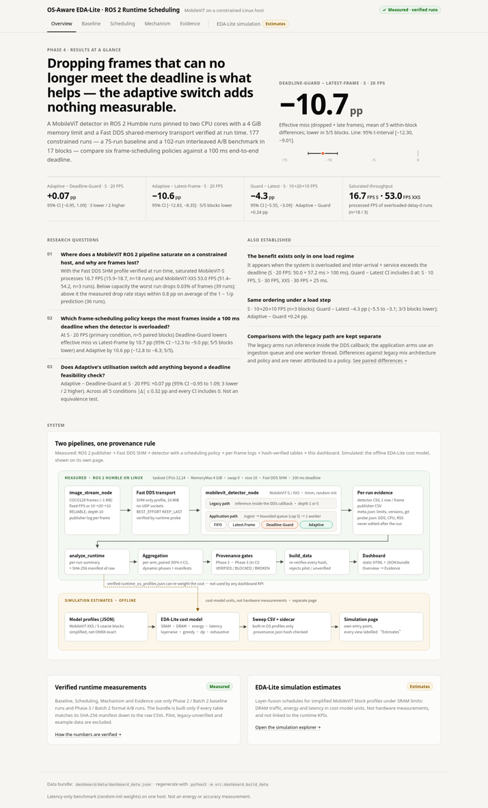 | 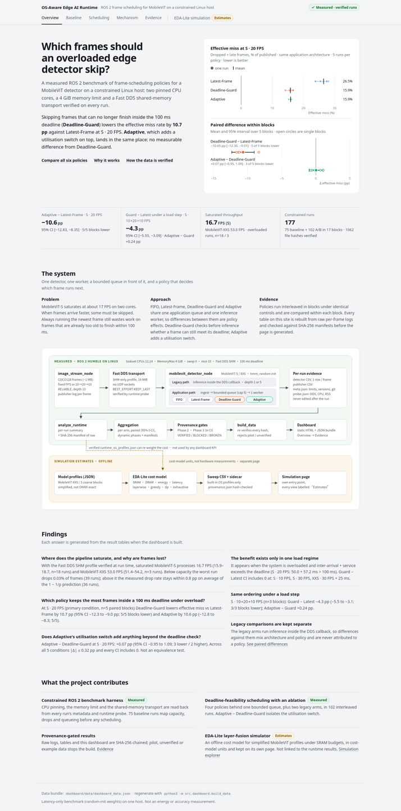 |
| Scheduling（桌面，50% 縮圖） | 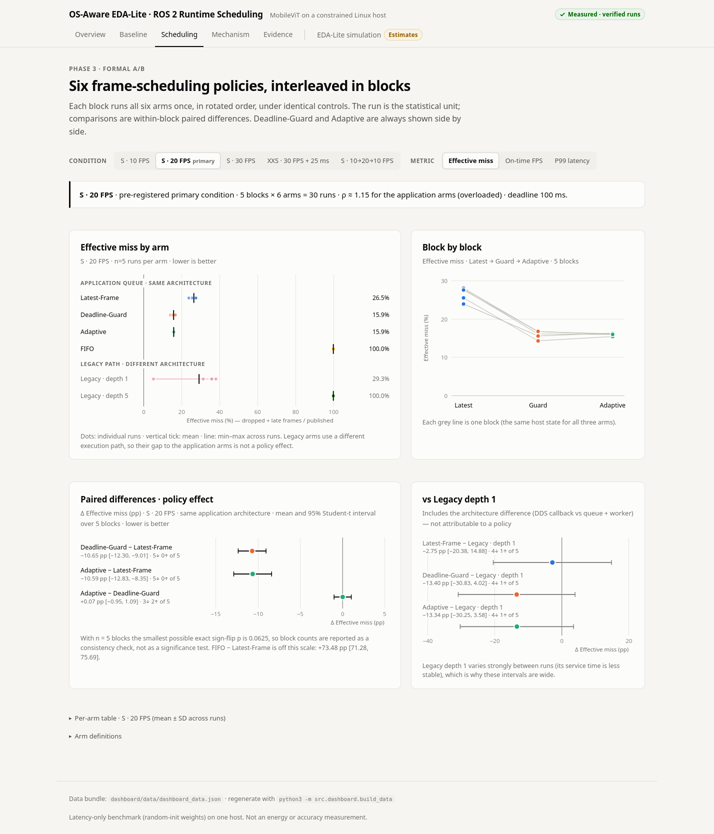 | 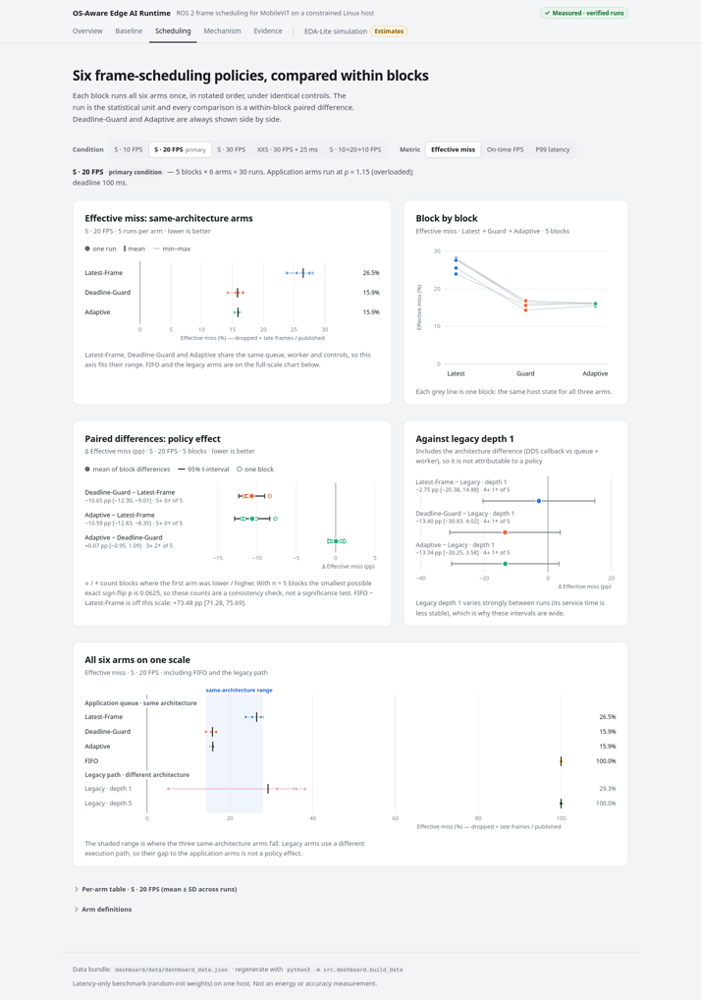 |
| Mechanism（dark，50% 縮圖） | 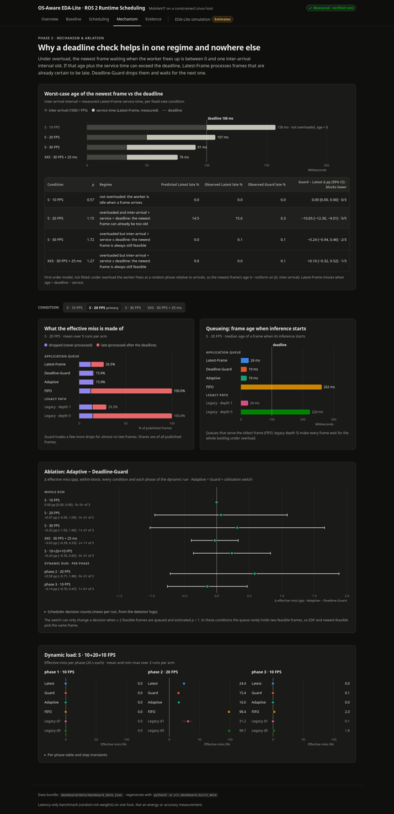 | 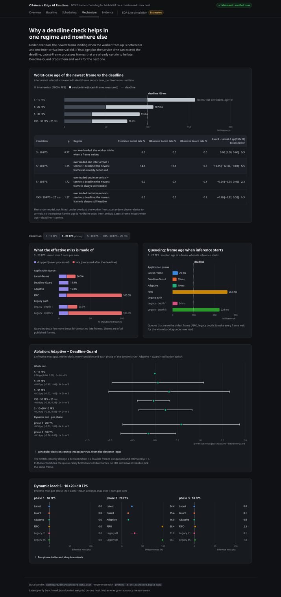 |
| Scheduling（手機 390 px） | 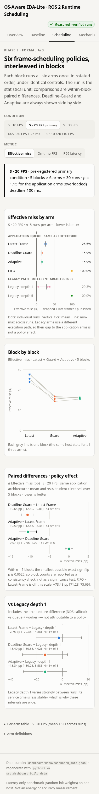 | 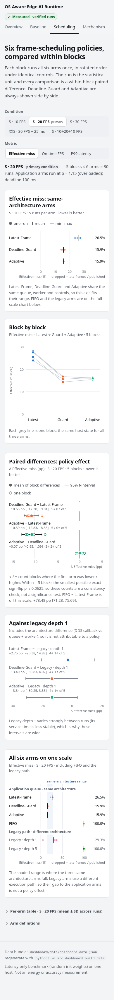 |

`docs/images/dashboard_*.png`（README 使用的 7 張截圖）已用新版重新產生。

## 5. 瀏覽器驗證

驗證環境：

- 真實 Firefox（headless），透過 geckodriver 的 W3C WebDriver 驅動，client 使用自寫的 stdlib 腳本。
- Server 只綁定 `127.0.0.1`。
- 手機 390 px 使用 iframe 取得真實 viewport。

| 檢查 | 範圍 | 結果 |
|---|---|---|
| 版面稽核（JS 錯誤、頁面水平捲動、SVG 文字超出 panel、文字重疊、元素超出 viewport） | light / dark × 1440 / 820 px × 6 頁 + Scheduling 4 condition × 3 metric 的 deep link；390 px × 6 個狀態 | **CLEAN**（0 個問題） |
| 篩選器（真實點擊） | Scheduling 5 condition × 3 metric = 15 種組合：`aria-pressed`、URL hash、主圖 3 列、band、block 點數 = 3 × block 數 | 15/15 OK |
| Deep link 重新載入 | `#scheduling?c=s30&m=p99_latency_ms` | 狀態正確還原 |
| 真實滑鼠 hover tooltip | Scheduling、Overview、Mechanism | 60/60、30/30、50/51 |
| 鍵盤 Tab focus tooltip | Scheduling | 46/46，focus ring 可見 |
| Impeccable detector（`impeccable detect`） | 2 個 HTML + 4 個 JS/CSS | `[]`（無發現） |
| 人工檢視 | 全頁截圖：desktop light / dark、手機 | 見 §4 |

Mechanism 那 1 個 hover 失敗：Adaptive 的「late」區段寬度小於 1 px，滑鼠落在該區段中心時會命中隔壁的 dropped 區段。這是原本就存在的情況，不是這次造成的；同一列的 dropped 區段與下方資料表都有相同資訊。

### 5.1 跨瀏覽器（Chrome / Safari 引擎）

Server 上沒有安裝 Chrome 或 Safari，而 Safari 只能在 macOS 上執行。因此改用 Playwright 1.65.1 提供的瀏覽器測試：

- **Chromium 158**：與 Chrome 使用同一個 Blink 引擎。
- **WebKit 27.2**：Safari 使用的引擎，UA 為 `Version/27.2 Safari/605.1.15`。

兩者都安裝在暫存目錄，沒有寫入 repo 或系統。WebKit 缺少 `libavif13`，以 `apt-get download` 取得後解壓到暫存目錄使用，沒有用 sudo，也沒有安裝到系統。

| 檢查 | Chromium 158 | WebKit 27.2 |
|---|---|---|
| 版面稽核：90 個狀態（desktop light / dark、820 px、390 px 手機 light / dark，`is_mobile` + touch）× 18 頁 / deep link | 0 個問題 | 0 個問題 |
| JS `pageerror` / `console.error` | 0 | 0 |
| 使用到的 CSS（`color-mix`、`text-wrap: balance`、`backdrop-filter`） | 全部支援 | 全部支援 |
| Scheduling 篩選器 5 × 3（真實點擊、block 點數、band、`aria-pressed`、hash） | 15/15 | 15/15 |
| Baseline / Mechanism / Simulation 篩選器 | OK，hash 正確，0 錯誤 | OK，hash 正確，0 錯誤 |
| Deep link 重新載入 | 正確還原 | 正確還原 |
| 真實滑鼠 hover（Overview / Scheduling / Mechanism） | 30/30、60/60、51/51 | 30/30、60/60、50/51 |
| 鍵盤 focus tooltip（Scheduling） | 51/51（Tab） | 51/51（Option+Tab，Safari 預設只用 Tab 走表單元件） |
| 手機觸控點擊圖表標記會顯示 tooltip | OK | OK |
| 手機上篩選器換行，不被裁切 | OK | OK |
| 展開 Evidence 所有表格後頁面是否水平捲動 | 否 | 否 |

WebKit 的 1 次 hover 失敗，與 Firefox 是同一個寬度不到 1 px 的「late」區段（見上）。

| Chromium · dark · Scheduling | WebKit · Overview | WebKit · iPhone 寬度 390 px |
|---|---|---|
| 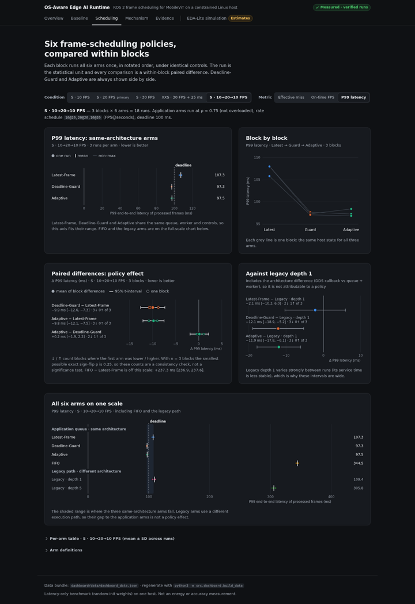 | 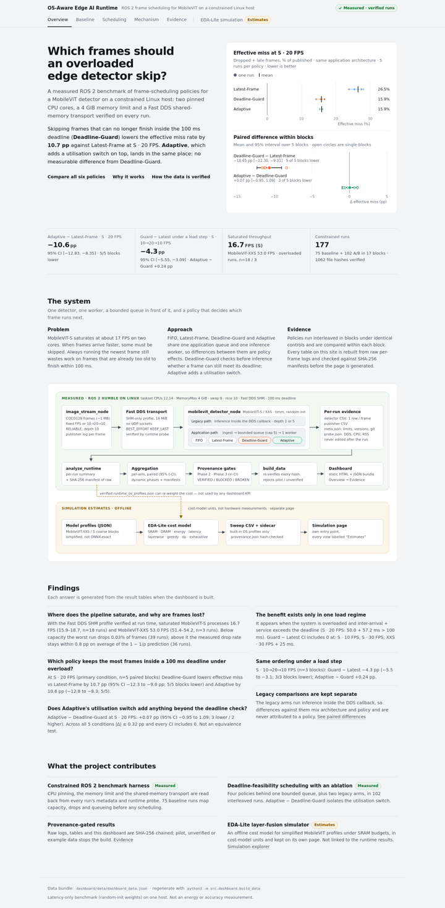 | 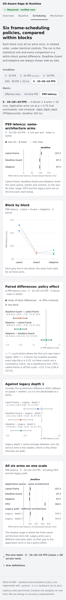 |

限制：這是 Safari 的引擎（WebKit / WPE on Linux），不是 macOS / iOS 上真正的 Safari App，字型也是 Linux 的 system sans。版面、CSS 支援、事件與互動行為已經涵蓋，但上線前仍建議在實機 Safari 上看一次。

## 6. 測試結果

| 檢查 | 結果 |
|---|---|
| `bash scripts/ci_checks.sh all` | exit 0 |
| Unit / integration tests | 266 tests OK（1 skipped，與先前相同）；`tests.test_dashboard` 28/28 OK |
| Audit regressions | 0/17 reproduced |
| Phase 2 provenance | **VERIFIED**（75 raw CSV / 75 meta） |
| Phase 3 provenance | **VERIFIED**（102 runs @ `7f0f160`，dirty=false，runtime code 未變，17 blocks） |
| 表格重建（`check_table_regeneration.py`） | REPRODUCED（Phase 3 的 7 張表與 baseline conditions 逐 byte 相同） |
| `python3 -m src.dashboard.build_data --check` | CURRENT（191 inputs） |

## 7. Git diff（相對於 `560d181`）

```text
 dashboard/assets/app.js              | 254 +++++++++++++++----------
 dashboard/assets/architecture.svg    |  30 +--
 dashboard/assets/charts.js           |  22 ++-
 dashboard/assets/simulation.js       |   4 +-
 dashboard/assets/style.css           | 355 ++++++++++++++++++++++-------------
 dashboard/index.html                 |   6 +-
 dashboard/simulation.html            |   6 +-
 docs/images/dashboard_*.png          |   7 張截圖重新產生
 docs/images/ui_refinement/*.png      |   8 張 before/after（新增）
 README.md / AGENTS.md / src/__init__.py / scripts/setup_env.sh / report/final_report.md | 專案名稱統一
 docs/images/ui_refinement/*.png（跨瀏覽器）| 3 張
 report/UI_REFINEMENT_RESULT.md       |   新增
 report/ai_interaction_log.md         |   新增一節
```

`dashboard/data/`、`results/`、`src/`、`experiments/`：沒有變更。

## 8. 專案名稱統一

依擁有者決定，專案整體名稱統一為 **OS-Aware Edge AI Runtime**。

已更新的位置：

- Dashboard header 與頁面標題。
- `README.md` 標題與首句。
- `architecture.svg` 的 `<title>`。
- `AGENTS.md`：專案說明，並新增命名規則。
- `src/__init__.py` 的 docstring。
- `scripts/setup_env.sh` 的輸出文字。
- `report/final_report.md` 摘要中的專案名稱。

刻意保留不改的部分：

- **「EDA-Lite」**：仍然只用來指離線的 layer-fusion 模擬器元件。
- **「OS-aware EDA-Lite」**：在成本模型中指相對於 `pure` 的 OS-aware 列與圖表，是技術用語，維持原樣（例如 `plot_6lines.py`、`rebuild_eda_lite_figures.sh`）。
- **歷史紀錄**：舊報告、`ai_interaction_log.md` 的歷史段落、已暫停的 `src/ros2_yolo11/` 都不改寫。
- **資料**：`dashboard/data/` 不改。

## 9. 限制

- **字型**：沒有自帶字型檔，使用 system sans。不同作業系統的字形會不同；版面已在 Firefox、Chromium、WebKit 上驗證。
- **Safari**：只測了 WebKit 引擎（§5.1），沒有在實機 macOS / iOS Safari 上測試。
- **手機上的架構圖**：在容器內水平捲動（最小寬度 760 px），沒有另外畫一張手機版架構圖。
